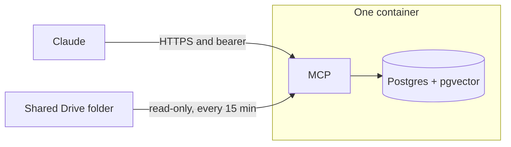

# Company Brain

One container. It reads one shared Google Drive folder into Postgres, and Claude searches that index. The chat model writes the answer. This service returns chunks, filenames, and scores.

The container holds the MCP app, Postgres, and the embedding model. Data sits on a volume. Render is the first host: one link, Deploy, then the service URL. A later host runs the same image with a volume and HTTPS. The app itself stays the same.

```
https://render.com/deploy?repo=https://github.com/meteordefect/memory-system
```

## How it fits together



Claude sends a question to `https://<service>.onrender.com/mcp` with a bearer key. The service embeds the question, searches the chunks, and returns the best ones. Every 15 minutes the same process reads the Drive folder and replaces the chunks for files that changed. ChatGPT uses this URL only after OAuth exists. Until then, Claude is the client.

## Status

Plan, not built. The spec is [docs/plan.md](docs/plan.md). The first milestone is a local test: Postgres, the two MCP tools, and a search against a loaded document. The Render blueprint is the step after that test passes.

`main` and `hindsight` still hold the earlier Hindsight workshop. This branch is the new build. The `render.yaml` in the tree is still that workshop's blueprint.

## Stack

| Component | Choice |
| --- | --- |
| Runtime | Python 3.11+, FastAPI + FastMCP, stateless Streamable HTTP |
| Storage | Postgres 16 + pgvector, in the web container, on a 10 GB disk |
| Embedder | BGE-small, 384 dimensions, ONNX. Same model, smaller runtime than PyTorch |
| Keyword search | Postgres `tsvector`, merged with the vector results |
| Ingestion | Drive sync every 15 minutes, inside the web process |
| TLS | Render, on `*.onrender.com` |
| Deploy | One image. On Render, `render.yaml` plus a 10 GB disk |

The free Render instance sleeps, and a sleeping service does not sync. Leave the plan on `1c-2g`.

## Tools

Served at `/mcp`.

| Tool | What it does |
| --- | --- |
| `search` | Top chunks for a query, with filename and score. Default 5 |
| `list_sources` | What is indexed, how many chunks, when the last sync ran |

Ingest is not a tool. The sync pulls the Drive folder. The model cannot send the server a URL to fetch.

## What a sync does

Every 15 minutes the service lists every file in the folder and its subfolders. Google Docs, Sheets, and Slides are exported to text. PDF, Word, Excel, Markdown, and plain text are read as files. Each changed file is chunked at 512 tokens with 64 overlap, embedded, and written in place of that file's old chunks. A file that left the folder loses its rows.

The Drive folder is shared with a Google Cloud service account. The account is read-only. On Render the key is `GDRIVE_SERVICE_ACCOUNT_JSON` and the folder id is `GDRIVE_FOLDER_ID`.

## Security

Render generates `MCP_API_KEY`. Claude sends it as `Authorization: Bearer <key>`, the same header the last workshop used. Anyone with that key can search the whole folder. The service does not copy each person's own Drive permissions.

Postgres listens on localhost inside the container. Its files sit on the service disk. The service account can read only the folder shared with it.

The web service is $25 a month. The 10 GB disk is $2.50 a month. Drive remains the source of the documents. A larger disk later is a size change on the same service.

## Layout once built

```
render.yaml           the Blueprint the deploy link reads
Dockerfile            image, with BGE-small baked in
app/                  FastAPI + FastMCP tools
sync_gdrive.py        15-minute Drive sync
docker-compose.yml    local test only
```

Schema, the Blueprint, and the Claude steps are in [docs/plan.md](docs/plan.md).
