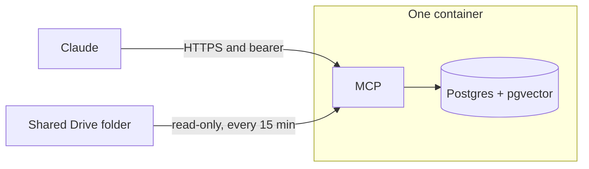

# Company Brain

One container. It reads one shared Google Drive folder into Postgres, and Claude searches that index. The chat model writes the answer. This service returns chunks, filenames, and scores.

The container holds the MCP app, Postgres, and the embedding model. Data sits on a volume. Render is the first host: one link, Deploy, then the service URL. A later host runs the same image with a volume and HTTPS. The app itself stays the same.

```
https://render.com/deploy?repo=https://github.com/meteordefect/memory-system
```

## How it fits together



Claude sends a question to `https://company-brain-xxxx.onrender.com/mcp` with a bearer key. Render assigns the `xxxx` once, when that company deploys, so each service has its own host. The host stays the same on later deploys. The service embeds the question, searches the chunks, and returns the best ones. Every 15 minutes the same process reads the Drive folder and replaces the chunks for files that changed. ChatGPT uses this URL only after OAuth exists. Until then, Claude is the client.

## Status

Claude search is proven on a test service at `https://company-brain-4f8c.onrender.com/mcp` with the bearer key. The sample price list is in the index. Drive sync runs after `GDRIVE_FOLDER_ID` and `GDRIVE_SERVICE_ACCOUNT_JSON` are set and that folder is shared with the service account. The test service has both values. Files show up once the share is in place.

Staff sign-in by company email is WorkOS, and it is not part of this deploy. Today everyone who has the bearer key can search.

`main` and `hindsight` still hold the earlier Hindsight workshop. This branch is the new build. `render.yaml` is this app's Blueprint.

## Stack

| Component | Choice |
| --- | --- |
| Runtime | Python 3.11+, FastAPI + FastMCP, stateless Streamable HTTP |
| Storage | Postgres 16 + pgvector, in the web container, on a 10 GB disk |
| Embedder | BGE-small, 384 dimensions, ONNX. Same model, smaller runtime than PyTorch |
| Keyword search | Postgres `tsvector`, merged with the vector results |
| Ingestion | Drive sync every 15 minutes, inside the web process |
| TLS | Render, on `*.onrender.com` |
| Deploy | One image. On Render, `render.yaml` plus a 10 GB disk |

The free Render instance sleeps, and a sleeping service does not sync. Leave the plan on `1c-2g`.

## Tools

Served at `/mcp`.

| Tool | What it does |
| --- | --- |
| `search` | Top chunks for a query, with filename, chunk id, and score. Default 5. Skips soft-deleted and heavily demoted chunks |
| `list_sources` | What is indexed, how many live chunks, when the last sync ran |
| `feedback` | Mark a returned chunk `useful`, `wrong`, or `outdated`. Does not edit Drive |

Ingest is not a tool. The sync pulls the Drive folder. The model cannot send the server a URL to fetch.

## What a sync does

Every 15 minutes the service lists every file in the folder and its subfolders. New and changed files go on a queue and are taken one at a time, so a first sync of many files does not load them together. Google Docs, Sheets, and Slides are exported to text. PDF, Word, Excel, Markdown, and plain text are read as files. A PDF is read one page at a time. Each file is chunked at about 512 tokens with 64 overlap. The model embeds 8 chunks at a time, the file is saved, and the next file starts. A restart skips files already saved and continues the rest. A file that left the folder is soft-deleted when that pass finishes, and search stops returning it. A chunk marked wrong or outdated twice drops out of default search. Marking it useful brings it back.

The Drive folder is shared with a Google Cloud service account. The account is read-only. On Render the key is `GDRIVE_SERVICE_ACCOUNT_JSON` and the folder id is `GDRIVE_FOLDER_ID`.

## Connect the folder

Do this once per company, before you send anyone the Claude link. One person creates the reader in Google Cloud. That click generates an email ending in `.iam.gserviceaccount.com`. The folder owner then opens Google Drive and shares the company folder with that email as Viewer. The people who search in Claude do neither step.

Do the Google steps first. On deploy, Render generates `MCP_API_KEY` and shows two empty boxes: `GDRIVE_FOLDER_ID` and `GDRIVE_SERVICE_ACCOUNT_JSON`. Those boxes are the startup step. Render cannot create the Google robot, and the repo cannot ship a filled-in key. A key in the deploy link would be public, and every service that had it could read every folder shared with that robot. Each company pastes its own folder id and its own JSON. A service that is already live can take the same two values later.

The reader is a Google Cloud service account. The app asks Google for read-only Drive access. You still have to share the folder with that email. A link set to "anyone with the link" leaves the robot out.

Someone has to create that reader by hand. Render cannot do it. A normal Google login is enough: open Google Cloud, create a free project, and download the key. There is no Cloud bill and no existing Cloud account to buy. For this test, that part is already done. The folder owner only logs into Google Drive, clicks **Share**, and adds the email as **Viewer**. The people who search in Claude do not log into Google.

### 1. Create a Google Cloud project

1. Open [console.cloud.google.com](https://console.cloud.google.com/) and sign in with a Google account you control. This account owns the robot. It is not each staff login.
2. Open the project picker in the top bar and choose **New project**.
3. Name it `company-brain` and create it.
4. Select that project. The top bar must show `company-brain` for every step after this. Enabling an API or creating a key in the wrong project produces a key that cannot read the folder.

An existing project you control is fine too. Stay in that one project for the rest of these steps.

### 2. Turn on the Drive API

1. Open the [Google Drive API page](https://console.cloud.google.com/apis/library/drive.googleapis.com).
2. Check the project name in the top bar.
3. Click **Enable**. If the button already says **Manage**, the API is on.

### 3. Create the reader and download its key

1. Open [Service accounts](https://console.cloud.google.com/iam-admin/serviceaccounts).
2. Click **Create service account**.
3. Service account name: `company-brain-drive`. Leave the generated id as it is. You cannot change it later.
4. Click **Create and continue**.
5. Leave the project role empty. This robot does not need Owner, Editor, or any other role on the Cloud project. Click **Continue**, then **Done**.
6. In the list, click the email of `company-brain-drive`. It looks like `company-brain-drive@steady-arbor-4821.iam.gserviceaccount.com`.
7. Open the **Keys** tab.
8. Click **Add key**, then **Create new key**.
9. Choose **JSON** and click **Create**. The browser downloads one `.json` file. Google will not offer that file again.

Keep that file off git, off email, and out of the Drive folder. Paste it only into Render. If **Create new key** is refused, the Cloud organization is blocking keys. Create the project under a normal Google account, or ask the Cloud admin to allow a key on this one project.

### 4. Share the folder with that reader

1. Open the downloaded JSON in a text editor. Copy the `client_email` value. That is the only address you share with.
2. In Google Drive, open the company folder while signed in as someone allowed to share it.
3. Click **Share**.
4. Paste the `client_email`.
5. Set the role to **Viewer**.
6. Share it. If Google says the address has no inbox, or offers **Notify people**, turn notification off and share anyway. The robot has no mailbox.

The robot can then read that folder and its subfolders. It cannot edit them, and it cannot see the rest of Drive. On a Shared drive, add the same email on this folder as **Viewer**.

### 5. Copy the folder id

Open the folder and copy the address bar. It looks like this:

```text
https://drive.google.com/drive/folders/1aH7kP2mQw9sLd4nT8vXcR6bY0eFj3uNz
```

The folder id is the long string after `/folders/` and before `?`. In the address above, the id is `1aH7kP2mQw9sLd4nT8vXcR6bY0eFj3uNz`. Leave out `https://`, `/folders/`, and `?usp=sharing`.

### 6. Give both values to Render

On the deploy screen, paste them when Render asks:

| Key | Value |
| --- | --- |
| `GDRIVE_FOLDER_ID` | The folder id from the address bar |
| `GDRIVE_SERVICE_ACCOUNT_JSON` | The whole downloaded file |

The JSON value starts with `{` and includes `"type": "service_account"`. Paste the file as it downloaded. Leave Render's generated `MCP_API_KEY` alone.

To add them after the service is already live:

1. In the Render dashboard, open the `company-brain` service.
2. Click **Environment** in the left pane.
3. Add `GDRIVE_FOLDER_ID` and `GDRIVE_SERVICE_ACCOUNT_JSON` with the values above.
4. Open the save menu and choose **Save and deploy**. Render restarts the service with the new values, and the first sync runs on startup. **Save only** stores the values and the running service keeps the old ones until a later deploy. A rebuild is unnecessary. The key is read when the process starts.

The key stays on Render. This repo does not contain one.

### 7. Copy the service URL

When the service is live, open it in the Render dashboard. The URL looks like this:

```text
https://company-brain-xxxx.onrender.com
```

The blueprint names every service `company-brain`. Render adds the `xxxx` so two companies do not land on the same host. Copy the host from that service page. It is assigned once and stays put on later deploys.

In Claude, the connector URL is that host with `/mcp` on the end:

```text
https://company-brain-xxxx.onrender.com/mcp
```

The header is still `Authorization`, and the value is `Bearer` plus the `MCP_API_KEY` from the same service.

### 8. Confirm in Claude

Ask Claude: "What sources are indexed?"

The sample price list is there from the first boot. Drive files appear beside it after a sync. The first sync runs when the new deploy goes live. After that, the service checks the folder every 15 minutes, so a file added just after a sync can take that long to show up.

These files are indexed, including files in subfolders:

- Google Docs, Sheets, and Slides
- PDF
- Word `.docx`
- Excel `.xlsx`
- Markdown and plain text

Pictures, `.doc`, `.xls`, and anything else are skipped. A file over 20 MB is skipped. Removing a file from the folder hides it from search on the next sync.

If Claude still shows only the price list, open the folder's Share dialog and check that the `client_email` is listed as Viewer. Then use **Save and deploy** again, or wait for the next 15-minute check.

## Security

Render generates `MCP_API_KEY`. Claude sends it as `Authorization: Bearer <key>`, the same header the last workshop used. Anyone with that key can search the whole folder. The service does not copy each person's own Drive permissions.

Postgres listens on localhost inside the container. Its files sit on the service disk. The service account can read only the folder shared with it.

The web service is $25 a month. The 10 GB disk is $2.50 a month. Drive remains the source of the documents. A larger disk later is a size change on the same service.

## Layout once built

```
render.yaml           the Blueprint the deploy link reads
Dockerfile            image, with BGE-small baked in
app/                  MCP tools and the Drive sync
```

Schema, the Blueprint, and the Claude steps are in [docs/plan.md](docs/plan.md). Queue and chunk settings are in [docs/tech-specs.md](docs/tech-specs.md).
