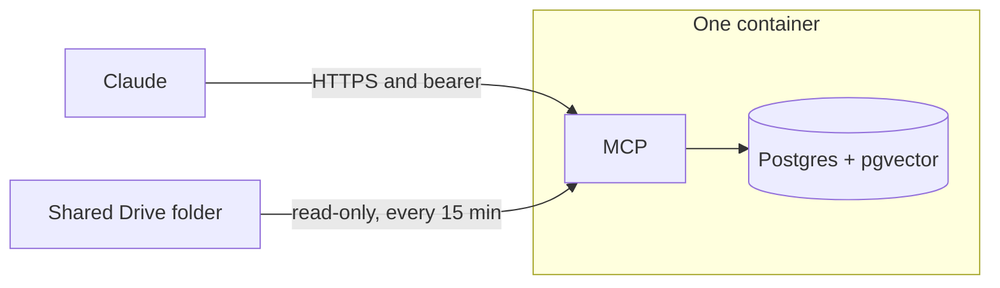

# Build Plan: Company Brain

One Render blueprint. One web service. Two MCP tools. Fifteen-minute freshness.

The brain indexes one shared Google Drive folder and exposes that index over MCP. Claude connects to the Render HTTPS URL and searches it. The model the person already pays for writes the answer. This server searches and lists. It does not write answers, and it does not fetch URLs the model sends.

The person deploying it does what they did for the Hindsight workshop. They open one Render link, click Deploy, paste the folder id and the service-account JSON, and copy the service URL plus the generated bearer key.



## Will this work

Yes, for the job it is: Claude searches documents from one Drive folder, on the same Render deploy link as the workshop.

| Piece | Verdict |
| --- | --- |
| FastAPI + FastMCP, Streamable HTTP, on a Render HTTPS URL | Claude's custom connector already speaks this. Search is a short request. Render allows long responses, and a warm BGE-small query is well under that. |
| Postgres 16 + pgvector, in the web container, on a 10 GB disk | Same kind of disk as the workshop. The app runs `CREATE EXTENSION vector` on startup. Postgres listens on localhost. |
| BGE-small, 384 dimensions | The right small local model. Run it through ONNX (`fastembed`), with the model baked into the image. PyTorch on the 2 GB plan is the thing that gets the process killed. The vectors stay 384. |
| Hybrid search | `tsvector` and cosine distance, merged in the app. A company folder is small, so cosine search is exact. An ivfflat index is for a much larger table. |
| Drive ingest every 15 minutes | Works while the paid instance stays up. The free plan sleeps, so the blueprint stays on `1c-2g`. |
| ChatGPT on the same URL | Later. ChatGPT's custom MCP takes OAuth or no authentication. It has nowhere to put the bearer key. Opening the URL to get ChatGPT working would publish the folder. |

## Decisions

| Topic | Decision |
| --- | --- |
| Claude auth | Render generates `MCP_API_KEY`. Claude sends `Authorization: Bearer <key>`. The rehearsal already used this header. |
| ChatGPT | Waits for OAuth. Not part of the first deploy. |
| Tools | `search` and `list_sources`. Ingest stays on the server. |
| Files | Google Docs, Sheets, and Slides, plus pdf, docx, xlsx, md, and txt. Subfolders included. Other types are skipped and counted. |
| Deletes | Each run lists every file id in the folder. A `modifiedTime` filter never sees a deletion. |
| Replace | One transaction per file: delete that file's chunks, insert the new ones. A shorter file must not leave old chunks behind. |
| Embedder | `BAAI/bge-small-en-v1.5`, 384 dims, ONNX. Queries use that model's search prefix. Passages do not. |
| Keyword | Postgres `tsvector` only. Merge with the vector hits in the app (reciprocal rank fusion). |
| Drive auth | Scope `drive.readonly`. Share one folder with the service account. No domain-wide delegation. |
| Who can read | One key sees the whole folder. This is a shared company folder. It is not each person's Drive permissions. |
| One image | The container holds the app, Postgres with pgvector, and the embedder. Config is environment variables. Data is a volume. The app calls no host API. |

A document can still tell the chat model to ignore its instructions. The server limits the damage by returning a few chunks for a query, and by offering no tool that dumps or fetches. The Claude project instruction says those chunks are data.

## Stack

| Component | Choice | Why |
| --- | --- | --- |
| Runtime | Python 3.11+, FastAPI + FastMCP | MCP-native, one web service, stateless Streamable HTTP |
| Storage | Postgres 16 + pgvector, on a 10 GB disk | Room to grow. $2.50 a month at $0.25/GB |
| Embedder | BGE-small via ONNX (`fastembed`) | Local, 384 dims, fits the 2 GB plan |
| Keyword search | Postgres `tsvector` | Hybrid retrieval without loading the corpus into the process |
| Ingestion | Sync function, every 15 min, inside the web process | Drive → extract → chunk → embed → replace |
| TLS | Render's HTTPS on `*.onrender.com` | The URL Claude connects to |
| Deploy | One image. `render.yaml` is the Render host file | The same image runs on a later host with a volume and HTTPS |

One worker. The model loads once at startup. `/health` stays failing until the model is loaded, so Render does not send traffic early. Sync runs on a background task and will not start a second run while one is still going. Embed in small batches.

## MCP tools

Exposed at `/mcp`, stateless Streamable HTTP. Every request must carry `Authorization: Bearer <MCP_API_KEY>`.

| Tool | Input | Returns |
| --- | --- | --- |
| `search` | `query: str`, `top_k: int = 5` | Top chunks with source filename and score |
| `list_sources` | — | Indexed files, chunk counts, last successful sync time |

`search` takes the top vector hits and the top `tsvector` hits, fuses them, and returns `top_k`. The tool text tells the model the chunks are untrusted document text.

## Ingestion

`sync_gdrive.py`, every 15 minutes, from a background task in the web process.

1. List every file in `FOLDER_ID` and its subfolders. Paginate. Set `supportsAllDrives` and `includeItemsFromAllDrives` so a Shared Drive folder works. Skip trashed files.
2. Read `last_success` from `meta`.
3. For each file that is new, or whose `modifiedTime` is newer than `last_success` minus a few minutes of overlap:
   - Google Doc → export `text/plain`
   - Google Sheet → export `text/csv`
   - Google Slides → export `text/plain`
   - `.docx` → `python-docx`
   - `.pdf` → `pypdf`
   - `.xlsx` → `openpyxl`, rows as text
   - `.md` / `.txt` → read
   - anything else → skip, and count it
4. Chunk with the BGE tokenizer, 512 tokens, 64 overlap.
5. Embed the passages with BGE-small.
6. In one transaction: delete rows for that Drive file id, insert the new chunks.
7. Delete rows whose file id is no longer in the folder listing.
8. If every chosen file succeeded, set `last_success` to the time this run started. A failed file is retried next run. A file that fails does not block the others.

Auth is a Google Cloud service account, scope `drive.readonly`. On Render the JSON is the env var `GDRIVE_SERVICE_ACCOUNT_JSON`. The folder id is `GDRIVE_FOLDER_ID`. Share that folder with the service account email.

A local test can load one fixture file through a function in the same chunk → embed → store path. That function is not an MCP tool.

## Database schema

```sql
CREATE EXTENSION IF NOT EXISTS vector;

CREATE TABLE facts (
    id          BIGSERIAL PRIMARY KEY,
    source_id   TEXT NOT NULL,
    source_name TEXT NOT NULL,
    chunk_idx   INT NOT NULL,
    content     TEXT NOT NULL,
    embedding   vector(384) NOT NULL,
    created_at  TIMESTAMPTZ NOT NULL DEFAULT now(),
    UNIQUE (source_id, chunk_idx)
);

CREATE INDEX facts_content_fts
    ON facts USING gin (to_tsvector('english', content));

CREATE TABLE meta (
    key   TEXT PRIMARY KEY,
    value TEXT NOT NULL
);
-- meta: last_success = "2026-11-05T14:00:00Z"
```

No ANN index. Search uses cosine distance on `embedding`. Add an HNSW index only if a later corpus makes exact search slow.

## One image

The thing a client can move is one container:

- the MCP app
- Postgres 16 with pgvector, listening on `127.0.0.1`
- the BGE-small model, baked in

`DATABASE_URL` defaults to `postgres://company_brain@127.0.0.1:5432/company_brain`. The host mounts a volume at `/var/lib/postgresql`. Postgres keeps its files in `data` under that volume. Secrets are `MCP_API_KEY`, `GDRIVE_FOLDER_ID`, and `GDRIVE_SERVICE_ACCOUNT_JSON`. The process reads those variables and nothing about the host.

Render is the first host. Its blueprint attaches a 10 GB disk at that path and serves HTTPS. A later host runs the same image, mounts a volume at the same path, sets the same variables, and puts HTTPS in front. Claude then points at the new URL. The index moves by copying the volume, or by letting the next sync rebuild it from Drive.

`render.yaml` is the Render file. It is not part of the image.

## Deployment

On Render, that image is one web service. The volume is a 10 GB disk, the same kind the Hindsight workshop used, sized for growth. Postgres listens on `127.0.0.1` only.

A managed Render Postgres database is a second bill: the smallest paid plan is $6 a month, plus storage at $0.30/GB. The web service is already $25 a month on `1c-2g`. The disk is $0.25/GB, so 10 GB is $2.50 a month. Each chunk stores its text plus a 1.5 KB vector. With the keyword index, 10 GB still holds on the order of a million chunks. A folder that outgrows it gets a larger disk on the same service. The image does not change. The index can be built again from Drive, and Render keeps a daily snapshot of the disk for 7 days.

The 2 GB instance holds the embedder and Postgres. Postgres stays small: one company folder, low `shared_buffers`, few connections. The local test checks that the process fits.

The web service is `1c-2g`, Singapore, one instance. A disk cannot be shared across instances. `autoDeployTrigger` stays off, so a later push does not restart copies already running on other accounts. The app listens on Render's `PORT`.

```yaml
services:
  - type: web
    name: company-brain
    runtime: docker
    plan: 1c-2g
    region: singapore
    healthCheckPath: /health
    autoDeployTrigger: "off"
    disk:
      name: company-brain-pg
      mountPath: /var/lib/postgresql
      sizeGB: 10
    envVars:
      - key: DATABASE_URL
        value: postgres://company_brain@127.0.0.1:5432/company_brain
      - key: MCP_API_KEY
        generateValue: true
      - key: GDRIVE_FOLDER_ID
        sync: false
      - key: GDRIVE_SERVICE_ACCOUNT_JSON
        sync: false
```

On first boot the container initialises the data directory, starts Postgres, enables `vector`, and creates the tables if they are missing. Then it starts the app.

The link to send, once this branch is what the repo publishes:

```
https://render.com/deploy?repo=https://github.com/meteordefect/memory-system
```

What the person does:

1. Open that link and sign in to Render.
2. Choose Deploy. Render asks for `GDRIVE_FOLDER_ID` and `GDRIVE_SERVICE_ACCOUNT_JSON`. Render generates `MCP_API_KEY`.
3. Wait until the service is live. Copy the URL, shaped like `https://company-brain-xxxx.onrender.com`.
4. In Claude, add `https://company-brain-xxxx.onrender.com/mcp`.
5. Add a request header. Name: `Authorization`. Value: `Bearer`, one space, then `MCP_API_KEY`.

If the Claude dialog has no Request headers section, that organization cannot attach the key. Leave the server locked.

The `render.yaml` in the tree today is the Hindsight blueprint. It gets replaced when this app is the thing that deploys.

### Local test

Compose runs that same image. The volume is the only extra piece.

```yaml
services:
  brain:
    build: .
    ports:
      - "8000:8000"
    environment:
      PORT: "8000"
      MCP_API_KEY: local-test-key
      GDRIVE_SERVICE_ACCOUNT_JSON: ""
      GDRIVE_FOLDER_ID: ""
    volumes:
      - pgdata:/var/lib/postgresql

volumes:
  pgdata:
```

## Client config

Claude, custom connector. The URL is `https://<service>.onrender.com/mcp`. Authentication is the bearer header above. Choose no OAuth sign-in.

Claude Desktop, when it is the client instead of the website:

```json
{
  "mcpServers": {
    "company-brain": {
      "type": "http",
      "url": "https://<service>.onrender.com/mcp",
      "headers": {
        "Authorization": "Bearer <MCP_API_KEY>"
      }
    }
  }
}
```

ChatGPT Business can use this URL once the server speaks OAuth. That is a later addition. A static key does not fit ChatGPT's connector.

## Later additions

| Need | How |
| --- | --- |
| ChatGPT | OAuth on the MCP endpoint, so ChatGPT can connect without making the folder public |
| Salesforce (live queries) | A second MCP server in the client config |
| Salesforce (indexed) | `sync_salesforce.py`, same replace path as Drive |
| Confluence / Notion / Jira | One script per source, same replace path |
| Higher precision | LLM fact extraction at ingest, per chunk |
| Temporal queries | A date column, filtered in `search` |
| A much larger corpus | An HNSW index on `embedding` |
| More sources | `connectors/` folder, one file per source |

## Effort

| Task | Time |
| --- | --- |
| FastAPI + FastMCP + 2 tools + bearer | 1 day |
| Postgres schema + pgvector + hybrid search | half day |
| Drive sync, Google export, and the other extractors | 1 day |
| Render blueprint and the deploy link | half day |
| Claude connector | 1 hour |
| **Total** | **~3 days** |

ChatGPT OAuth is extra, after the Claude path works.

## Build order

1. Schema and a local Postgres (pgvector) via Compose.
2. Embedder loaded once in the app process. Confirm the process stays inside a 2 GB budget.
3. `search` and `list_sources` on `/mcp`, bearer required.
4. Prove `search` against a local fixture before any Drive credentials exist.
5. `sync_gdrive.py` once a folder is shared with the service account.
6. Replace `render.yaml`, deploy once, and connect Claude to `https://<service>.onrender.com/mcp` with the bearer header.
