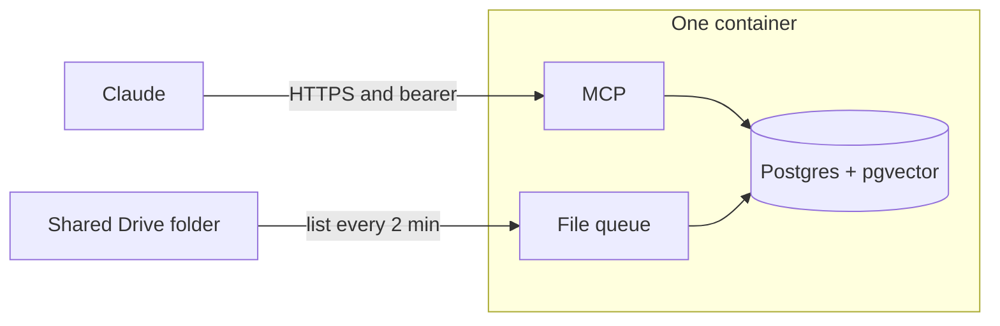
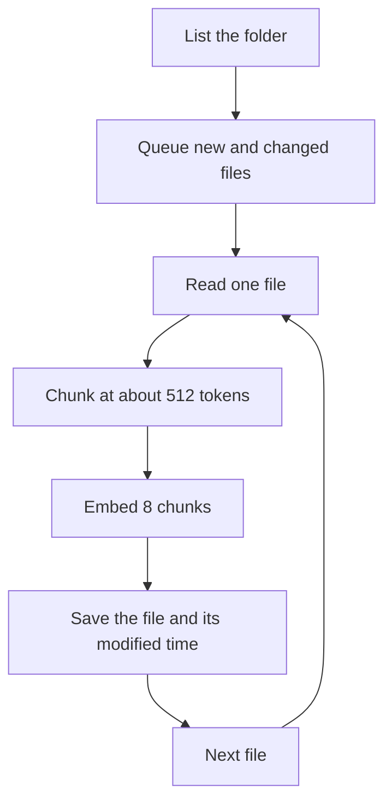

# Tech specs

Review sheet for the knobs. The student steps stay in the README. The build decisions stay in [plan.md](plan.md).

No extra queue package. `fastembed` only batches the embedding model. The file queue is this app: one thread, a list of Drive files, and a row in Postgres for each file that finished.

## Queue

A company folder can arrive as a hundred new files. The sync lists every file, keeps the ones that are new or changed, and works that list from the top. One file is downloaded, read, chunked, embedded, and saved before the next download starts. Search keeps running between embed batches.

Postgres is the record of progress. After a file is saved, `meta` gets `mtime:<Drive file id>` set to that file's `modifiedTime`. The next pass, including a pass after a restart, skips a file whose stored time is already current. A file that fails is left without that row, so it stays on the queue. `last_success` moves forward only when the pass had no failures.

That is the usual queue for one process. A broker such as Redis, Celery, RQ, or SQS is the usual choice when many machines share the work. This service is one container and one sync thread, so a broker would be a second service with nothing to do. A Postgres job table with `SKIP LOCKED` is the usual next step if more than one worker has to pull jobs. One thread does not need it.

`fastembed` is not that queue. Its `batch_size` is how many passages the ONNX model scores in one call. The library default is 256. On the 2 GB plan that default, on top of Postgres and the loaded model, is what one long PDF uses to get the process killed. This app calls it with 8.

## Settings

| Knob | Value | Where |
| --- | --- | --- |
| Folder check | every 2 minutes | `INTERVAL_SECONDS` in `app/drive.py` |
| File queue | one file, then the next | `sync_once` in `app/drive.py` |
| Finished file | `mtime:<file id>` = Drive `modifiedTime` | `meta`, written in `sync_once` |
| Retry | a failed file has no `mtime` row | `sync_once` |
| Chunk budget | 512 tokens, overlap 64 | `chunks` in `app/text.py` |
| Chunk window | 393 words, then step 344 words | `512 / 1.3` and `64 / 1.3` in `chunks` |
| Embed batch | 8 passages | `EMBED_BATCH` in `app/embed.py` |
| ONNX threads | 1 | `TextEmbedding(..., threads=1)` in `app/embed.py` |
| Model | `BAAI/bge-small-en-v1.5`, 384 dimensions | `app/embed.py` |
| PDF read | one page, then the reader is dropped | `_pdf_text` in `app/drive.py` |
| PDF fonts | `fonttools` so embedded fonts decode | `requirements.txt` |
| File cap | 20 MB, larger files are skipped | `MAX_BYTES` in `app/drive.py` |
| Replace | one transaction per file: soft-delete live chunks, then insert | `replace_source` in `app/store.py` |
| Search | default 5 chunks, cap 20, pool 20 | `search` in `app/search.py` |
| Merge | reciprocal rank fusion, k = 60 | `rrf` in `app/text.py` |
| Shown | `shown_count` + 1 when a chunk is returned | `mark_shown`, called from `search` |
| Feedback | `useful`, `wrong`, or `outdated` on a chunk id | `feedback` tool, rows in `chunk_feedback` |
| Useful | `useful_count` and `last_useful_at`; decay +0.25, cap 1 | `record_feedback` in `app/store.py` |
| Demote | wrong or outdated subtracts 0.5, floor 0 | `record_feedback` in `app/store.py` |
| Hidden | `deleted_at` set, or `decay_score` below 0.25 | `vector_hits` and `keyword_hits` |
| Freshness | 90-day half-life; never shown after 30 days ranks lower | `RANK_WEIGHT` in `app/store.py` |
| Postgres | `shared_buffers` 64 MB, `work_mem` 8 MB, `maintenance_work_mem` 64 MB, `max_connections` 20 | `render-start.sh` |
| Host | Render `1c-2g`, 2 GB, $25 a month. Disk 10 GB, $2.50 a month | `render.yaml` |

The chunk function does not call a tokenizer. It treats 1.3 words as about one token, which keeps a chunk inside the 512 tokens BGE-small reads. A chunk past that limit is truncated by the model.

Types that enter the queue: Google Docs, Sheets, Slides, PDF, `.docx`, `.xlsx`, Markdown, and plain text, including files in subfolders. Pictures, `.doc`, `.xls`, and anything else are left off the queue.
